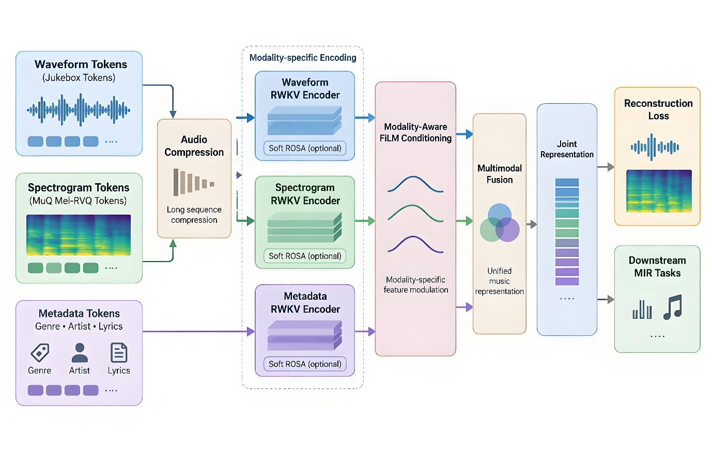

# MusicRWKV
MusicRWKV is a multimodal RWKV framework for music representation learning.

The framework jointly models:
- Waveform Tokens (Jukebox VQ-VAE)
- Spectrogram Tokens (MuQ Mel-RVQ)
- Metadata Tokens (Genre, Artist, Lyrics)

through a unified self-supervised objective based on RWKV. For more details, please refer to our [paper](https://arxiv.org/abs/2611.16718).


---
## Features
- Multimodal music pretraining
- RWKV backbone for long-context music modeling
- Waveform + Spectrogram + Metadata fusion
- Invertible compression module
- FiLM-based modality conditioning
- Optional Soft ROSA retrieval mechanism
- Support for downstream MIR tasks:
	- Music Tagging
	- Genre Classification
	- Key Estimation
	- Emotion Recognition
	- Instrument Classification
	- Pitch Classification
	- Singing Voice Analysis
---
# Audio Reconstruction Examples
MusicRWKV is trained with a multimodal reconstruction objective.

The following examples compare the original audio against the reconstructed audio generated from MusicRWKV predictions.
## Example
[Original Audio](original.wav)

[Reconstructed Audio](recovery.wav)

---
# Dataset Pipeline
MusicRWKV converts raw music recordings into multiple token streams.
```text
Audio (.mp3)
     │
     ├────────────► Jukebox VQ-VAE
     │                    │
     │                    ▼
     │             Waveform Tokens
     │
     └────────────► MuQ
                          │
                          ▼
                   Spectrogram Tokens
Metadata
(Genre / Artist / Lyrics)
          │
          ▼
     Text Tokenizer
          │
          ▼
      Meta Tokens
```
Each training sample is stored as:
```python
{
	'waveform': ...,
	'spectrogram': ...,
	'meta': {
		'genre': ...,
		'artist': ...,
		'lyric': ...
	}
}
```
---
# Model Architecture
MusicRWKV jointly models three modalities:
```text
Waveform Tokens
        │
Spectrogram Tokens
        │
Metadata Tokens
        ▼
     MusicRWKV
        ▼
 Shared Representation
        ▼
 Reconstruction Heads
```
The architecture consists of:
- Token Embeddings
- Invertible Compression Layers
- RWKV Backbone
- FiLM Conditioning
- Reconstruction Decoders

Optional:
- Soft ROSA Retrieval Module
---
# Pretraining Objective
The model is optimized using waveform, spectrogram,
metadata reconstruction losses together with a
lightweight reconstruction regularizer.

See Section 3.4 of the paper for detailed formulations.

---
# Pretraining Configuration
| Item               | Value             |
|--------------------|-------------------|
| Hidden Size        | 1024              |
| RWKV Layers        | 22                |
| Waveform Length    | 20000             |
| Spectrogram Length | 10000             |
| Metadata Length    | 500               |
| Batch Size         | 4                 |
| Optimizer          | Adam              |
| Learning Rate      | 1e-3              |
| Scheduler          | ReduceLROnPlateau |
| Training Epochs    | 400               |
---
# Installation
```bash
git clone https://github.com/tanjiarui/music-rwkv.git
cd music-rwkv
pip3 install -r requirement
pip3 install --no-build-isolation ./rosa\ soft
```
---
# Quick Start
## Step 1: Dataset Preprocessing
Convert audio and metadata into training tokens.
```bash
python3 preprocessing.py
```
---
## Step 2: Pretraining
```bash
python3 training.py
```
Checkpoints are automatically saved according to validation loss.

---
## Step 3: Reconstruction
Generate reconstructed audio from a pretrained checkpoint.
```bash
python3 inference.py
```
Output:
```text
original.wav
recovery.wav
```
---
# Repository Structure
```text
music-rwkv/

├── preprocessing.py
├── training.py
├── inference.py

├── model.py
├── module.py
├── utils.py

├── dataset/
│   ├── training/
│   └── validation/

└── readme.md
```
---
# Results
## Soft ROSA Ablation
| Model                 | Validation Accuracy |
|-----------------------|--------------------:|
| MusicRWKV             |                93.3 |
| MusicRWKV + Soft ROSA |                94.8 |
---
# Hugging Face Models
Pretrained checkpoints:

| Model                 | Link        |
|-----------------------|-------------|
| MusicRWKV             | Coming Soon |
| MusicRWKV + Soft ROSA | Coming Soon |
---
# Citation
```bibtex
@misc{tan2026musicrwkvmultimodalrwkvframework,
	title={MusicRWKV: A Multimodal RWKV Framework for Music Representation Learning},
	author={Terry Tan},
	year={2026},
	eprint={2611.16718},
	archivePrefix={arXiv},
	primaryClass={cs.SD},
	url={https://arxiv.org/abs/2611.16718}
}
```
---
# License
MIT License